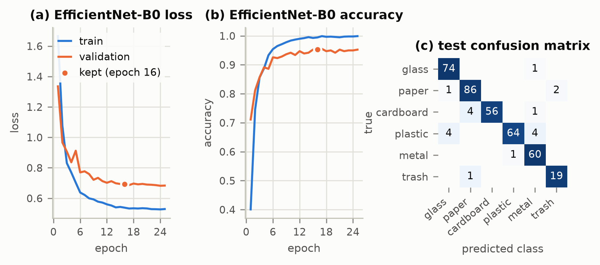
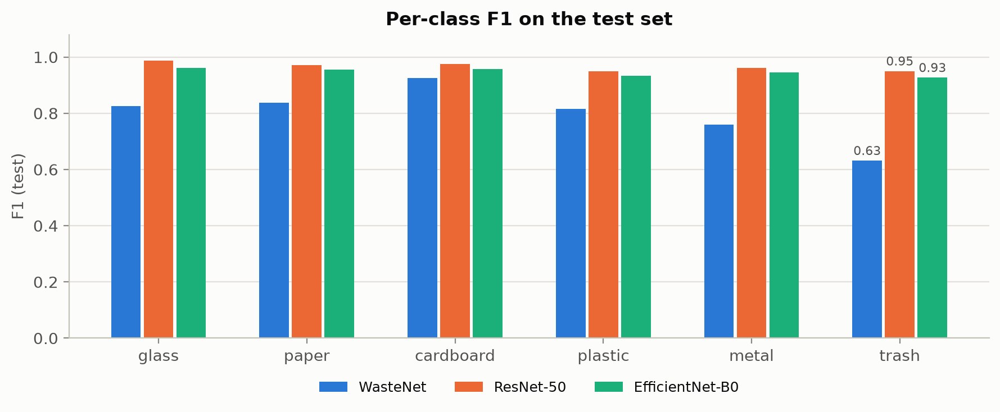
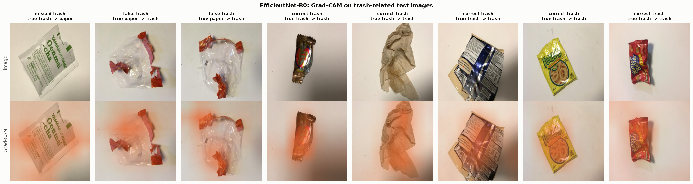
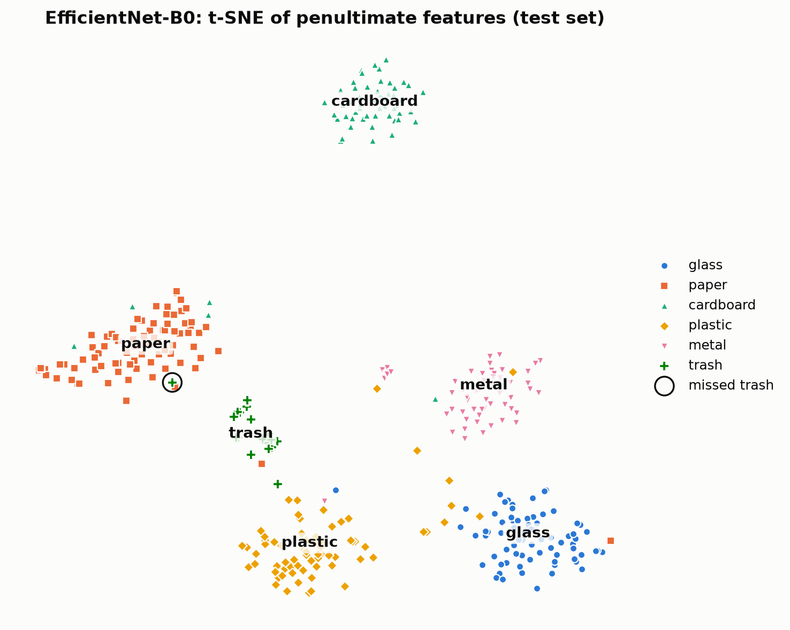

<div align="center">

# Waste Segregation at Source

### Multiclass waste-material classification with Convolutional Neural Networks on TrashNet

**PS-31 · Deep Learning · Challenge-Based Learning (CBL) · SRM Institute of Science and Technology, Tiruchirappalli**

[](https://www.python.org/)
[](https://pytorch.org/)
[](RA2311026050027_PS31.ipynb)
[](https://github.com/garythung/trashnet)
[](LICENSE)

</div>

---

## Overview

Smart bins and material-recovery facilities (MRFs) need to sort dry waste automatically. This project trains and evaluates CNNs that look at a photo of **one waste item** and assign it to one of six material classes:

`glass` · `paper` · `cardboard` · `plastic` · `metal` · `trash`

The `trash` class holds only **5.4 %** of the images, about a quarter of the size of `paper`. A model can therefore score high overall accuracy while failing on trash. Every model is selected and judged on **macro-F1** (all classes weighted equally), and the notebook reports **per-class** results and closes with a dedicated **error analysis of the trash class**.

> **Headline result:** a fine-tuned **EfficientNet-B0** (selected on validation macro-F1) reaches **test accuracy 0.95, macro-F1 0.95 and trash recall 0.95**, with only 4 M parameters and **18.5 ms per image on 4 CPU threads**. A CNN designed and trained from scratch reaches macro-F1 0.80.

## Results (held-out test set, 378 images)

| Model | Accuracy | Macro-F1 [95 % CI] | Trash precision | Trash recall | Trash F1 | Params | CPU latency* | Train time** |
|---|:---:|:---:|:---:|:---:|:---:|:---:|:---:|:---:|
| A · WasteNet (custom CNN, scratch) | 0.82 | 0.80 [0.75, 0.84] | 0.49 | 0.90 | 0.63 | 3.4 M | 38.9 ms | 5.8 min |
| B · ResNet-50 (ImageNet, fine-tuned) | 0.97 | 0.97 [0.94, 0.98] | 0.95 | 0.95 | 0.95 | 23.5 M | 45.8 ms | 3.6 min |
| **C · EfficientNet-B0 (ImageNet, fine-tuned), selected** | **0.95** | **0.95 [0.92, 0.97]** | **0.90** | **0.95** | **0.93** | **4.0 M** | **18.5 ms** | **3.0 min** |
| C without class weights (ablation) | 0.96 | 0.96 [0.93, 0.98] | 0.95 | 0.95 | 0.95 | 4.0 M | 18.5 ms | 2.7 min |

<sub>\* one image, batch size 1, 4 CPU threads (proxy for an embedded smart-bin controller). \** NVIDIA RTX 4050 laptop GPU, bf16 mixed precision. The model is chosen on the **validation** set, so the test set stays an unbiased estimate; ResNet-50's slightly higher test score is inside the overlapping confidence intervals.</sub>

**Per-class test F1 of the selected model:** glass 0.96 · paper 0.96 · cardboard 0.96 · plastic 0.93 · metal 0.95 · trash 0.93

<p align="center">
  
</p>

<p align="center">
  
</p>

## What is inside

| | |
|---|---|
| **Data audit** | MD5 hashing revealed **3 identical photos filed under two different classes** (e.g. `metal91.jpg` = `glass115.jpg`). The contradictory copies are removed. Near-duplicate shots of the same object (thumbnail cosine similarity ≥ 0.98) are grouped and never split across train / test. |
| **Leakage-safe split** | Stratified, group-aware 70 / 15 / 15 split with a fixed seed, saved to `results/split.csv`. |
| **Three CNNs** | A custom VGG-style CNN trained **from scratch** (*WasteNet*, 3.4 M params) vs. ImageNet-pretrained **ResNet-50** and **EfficientNet-B0**, fully fine-tuned with discriminative learning rates. |
| **Class imbalance** | Inverse-frequency **class-weighted cross-entropy** plus label smoothing, macro-F1 for model selection, and an **ablation** that retrains the best model without the weights to measure their effect. |
| **Honest evaluation** | Accuracy, balanced accuracy, macro / weighted F1, Cohen's κ, top-2 accuracy, macro ROC-AUC, per-class P / R / F1, confusion matrices, PR curves and **95 % bootstrap confidence intervals** (the test set holds only 20 trash images). |
| **Explainability** | Misclassified-image gallery with a reason for each error, trash false negatives / positives, confidence analysis, **t-SNE** of learned features and **Grad-CAM** heat maps. |
| **Deployment view** | Parameters, model size, and GPU / 4-thread CPU latency per image, as a proxy for an embedded smart-bin controller. |

## Trash-class analysis

* The selected model finds **19 of 20 trash items** and raises **2 false trash alarms**. Only 3 of its 19 test errors involve trash.
* The one **missed trash item** is a printed tea sachet predicted as *paper*. Trash is defined by *recyclability* (a multi-layer laminate), not by how the material looks, and in the t-SNE of the learned features the sachet lies inside the paper cluster.
* Both **false trash alarms** are photos of a clear plastic bag that TrashNet labels *paper*: **label noise**, of the same kind as the three conflicting duplicates removed during the audit.
* **Grad-CAM** shows that correct trash predictions focus on the wrapper itself (crinkled, printed, flexible packaging), not on the background.
* **Ablation:** for the pre-trained network the class-weighted loss makes no measurable difference (1–3 images, inside the CIs), because ImageNet features already form a separate trash cluster. For the scratch CNN the weighting raises trash recall (0.90) at the cost of precision (0.49).
* Most remaining errors are **material look-alikes**: clear or green PET vs. glass, plastic lids and canisters vs. metal cans, white paperboard vs. paper.

<p align="center">
  
</p>

<p align="center">
  
</p>

## Method

**Dataset.** [TrashNet](https://github.com/garythung/trashnet), `dataset-resized` version: 2,527 RGB photos (512 × 384) of single items on a white board. Classes: glass 501, paper 594, cardboard 403, plastic 482, metal 410, trash 137. After the audit, 2,521 images are used: 1,766 train / 377 validation / 378 test.

**Pre-processing.** Resize to 224 × 224 and ImageNet normalisation. Training-only augmentation: rotation ±20°, random resized crop (60–100 % area), horizontal and vertical flips, and mild colour jitter. Hue jitter is kept small because colour is a genuine material cue.

| | WasteNet (scratch) | ResNet-50 | EfficientNet-B0 |
|---|---|---|---|
| Initialisation | random | ImageNet | ImageNet |
| Trainable layers | all | all (no frozen layers) | all (no frozen layers) |
| Peak LR (backbone / head) | 3e-3 | 2e-4 / 2e-3 | 5e-4 / 3e-3 |
| Weight decay | 0.05 | 0.01 | 0.01 |
| Max epochs / early-stopping patience | 60 / 15 | 25 / 10 | 25 / 10 |
| Shared settings | AdamW, one-cycle LR (15 % warm-up, cosine decay), batch 32, class-weighted CE + label smoothing 0.1, bf16 mixed precision, keep best validation macro-F1 |||

## Requirements

**Software**

| Package | Minimum | Tested | Used for |
|---|---|---|---|
| Python | 3.10 | 3.14.4 | |
| torch | 2.4 | 2.14.1 | model definition, training, mixed precision |
| torchvision | 0.19 | 0.29.1 | pretrained ResNet-50 / EfficientNet-B0, image transforms |
| numpy | 1.26 | 2.5.4 | arrays, bootstrap resampling |
| pandas | 2.0 | 3.1.0 | tables, metrics export |
| scikit-learn | 1.3 | 1.9.1 | stratified split, metrics, t-SNE |
| matplotlib | 3.7 | 3.11.2 | all figures |
| pillow | 10.0 | 13.0.0 | image loading |
| notebook, ipykernel | 7.0, 6.29 | | running the `.ipynb` |

All of them are listed in [`requirements.txt`](requirements.txt).

**Hardware**

* An NVIDIA GPU with ≥ 4 GB memory is recommended (developed on an RTX 4050 laptop GPU, 6 GB). A full run takes about **25 min** there.
* The notebook also runs on CPU, but training then takes several hours.
* About 1 GB of disk space for the dataset, the ImageNet weights and the trained models. Internet access is needed on the first run.

## Repository structure

```
.
├── RA2311026050027_PS31.ipynb          # the complete notebook, executed, with all outputs
├── RA2311026050027_PS31_Report.pdf     # two-page report (CBL Part D format)
├── report/report.html                  # source of the report (printed to PDF)
├── figures/                            # every figure produced by the notebook (PNG)
├── results/                            # metrics CSV / JSON, per-epoch histories, the saved split
├── requirements.txt
├── LICENSE
└── README.md
```

`data/` (dataset) and `models/` (trained weights, ~140 MB) are created when the notebook runs and are not committed.

## How to run

```bash
git clone https://github.com/KS-KARTHIK-05/CBL.git
cd CBL
python3 -m venv .venv && source .venv/bin/activate      # Windows: .venv\Scripts\activate
pip install -r requirements.txt
jupyter notebook RA2311026050027_PS31.ipynb             # then: Kernel -> Restart & Run All
```

The first notebook cell also installs the libraries with `%pip`, so on **Google Colab** you can simply upload the notebook and choose *Runtime → Change runtime type → GPU*. The dataset (43 MB) and the ImageNet weights are downloaded automatically. If a local copy of TrashNet is available, place its `dataset-resized` folder in `data/` and the download is skipped.

**Reproducibility:** fixed seed (42), deterministic cuDNN, saved split (`results/split.csv`), and library versions printed in the first code cell.

## Limitations

* TrashNet shows **one clean item on a white background under indoor light**. Real bins contain clutter, dirt, overlapping items and different cameras, so accuracy in the field will be lower.
* The test set holds only **20 trash images**, so trash metrics carry wide confidence intervals (reported in the notebook).
* `trash` is a catch-all class. Many trash items are themselves made of plastic or paper, which limits how separable it can ever be from those classes.

## References

1. G. Thung and M. Yang, *Classification of Trash for Recyclability Status*, CS229 Project Report, Stanford University, 2016. [Dataset](https://github.com/garythung/trashnet)
2. K. He, X. Zhang, S. Ren and J. Sun, *Deep Residual Learning for Image Recognition*, CVPR 2016.
3. M. Tan and Q. V. Le, *EfficientNet: Rethinking Model Scaling for Convolutional Neural Networks*, ICML 2019.
4. R. R. Selvaraju et al., *Grad-CAM: Visual Explanations from Deep Networks via Gradient-based Localization*, ICCV 2017.
5. L. van der Maaten and G. Hinton, *Visualizing Data using t-SNE*, JMLR 2008.

## Author

**Karthik.K.S** · Register No. RA2311026050027 · AIML-A
Department of CSE (Artificial Intelligence & Machine Learning), SRM Institute of Science and Technology, Tiruchirappalli

AI-assistance declaration: an AI assistant (Claude, Anthropic) was used for help with code and writing. All results come from running the notebook in this repository.

## License

Code released under the [MIT License](LICENSE). The TrashNet dataset is distributed by its authors under its own licence and is not included in this repository.
